# Neuro Stack Atlas

**Supplements, mapped by brain chemical.**
A visual, evidence-rated guide to how supplements reach dopamine, serotonin, GABA, glutamate, norepinephrine and acetylcholine: which ones are raw materials, which enzymes do the work, what those enzymes need, and why some supplements are gentler than others. Then it helps you build a stack, checks it against your medications, and shows you what changed in your own data.

**Live site:** https://el9995.github.io/neuro-stack-atlas/

> For learning only, not medical advice.

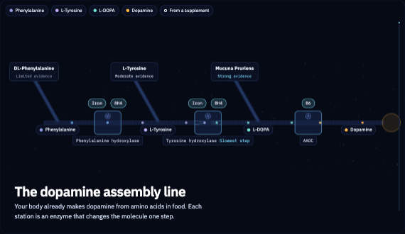

---

## What it is

Most supplement information is either marketing or a wall of studies. Neuro Stack Atlas sits in between: it explains the *mechanism* in plain language, shows how strong the evidence is, and puts safety first.

- **Learn the basics:** two scroll-driven scenes on the home page explain what neurotransmitters are, then foundation, cycling and recovery, before anyone picks a supplement.
- **Journey:** a seven-chapter scroll story that follows one capsule from the first swallow through the stomach, small intestine, liver, bloodstream and blood-brain barrier to the synapse. Each science caption cites its source.
- **Explore each neurotransmitter:** an animated assembly line built from that neurotransmitter's real pathway, with precursors, enzymes, the slowest step, cofactors and modulators. It ends on a clickable map.
- **Look up 65 supplements:** dose ranges, timing, food, tolerance, side effects, interactions and mechanism, each with an evidence rating.
- **Go deeper on 10 enzymes:** what each one does, what it needs and what controls its speed.
- **Stack builder:** an optional *About you* step (14 medication classes, a name lookup, 10 conditions), then name → build → check and approve → plan the day → save. The day planner has wake and sleep handles, meals and fasting windows, and timing tips that follow them.
- **Simulator:** watch a stack flow through all six pathways at once: the shared doorway into the brain, the slowest steps, and the cofactors each enzyme needs, from food or from the stack.
- **Tracker:** log doses and how you feel, and see patterns in your own data.
- **Games:** three short reaction and focus games, plus *Compare*, which puts your scores with no stack next to your scores on a stack.
- **Scanner:** paste a supplement label to match it against the site's data.

| | |
|---|---|
| 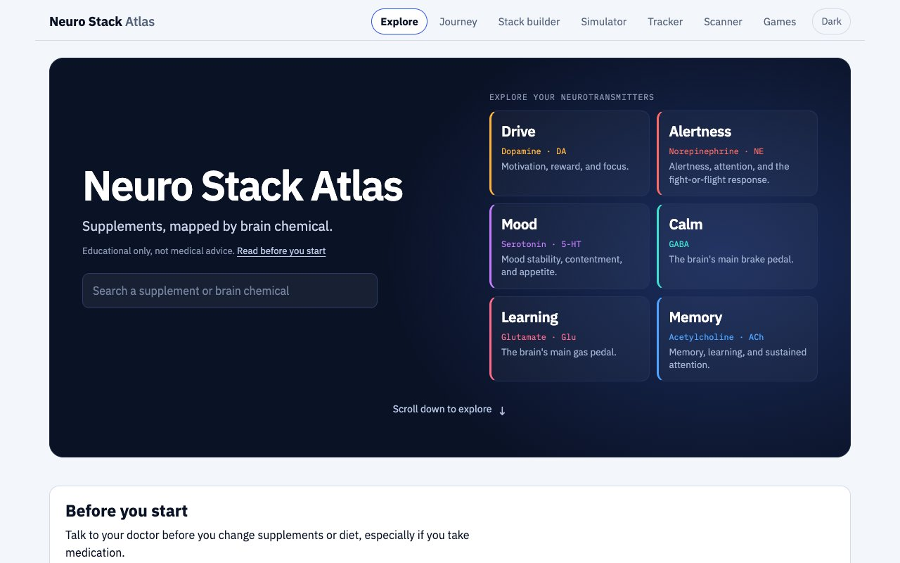 | 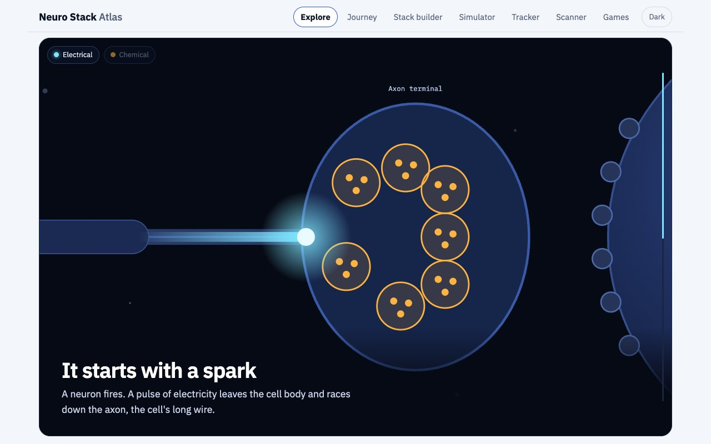 |
| 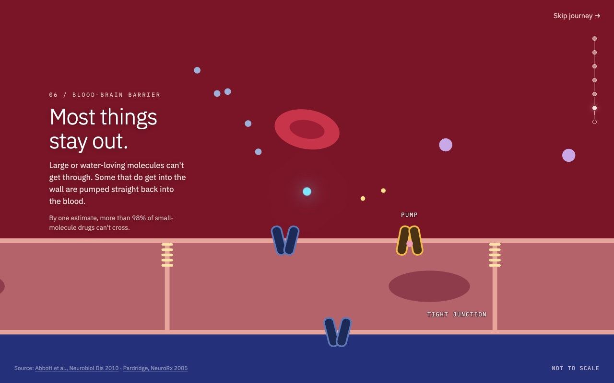 | 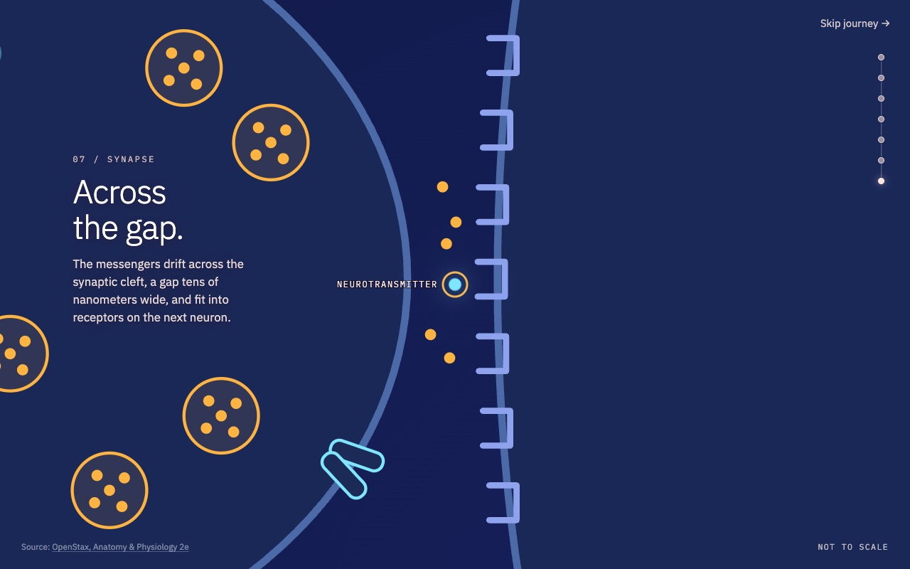 |
| 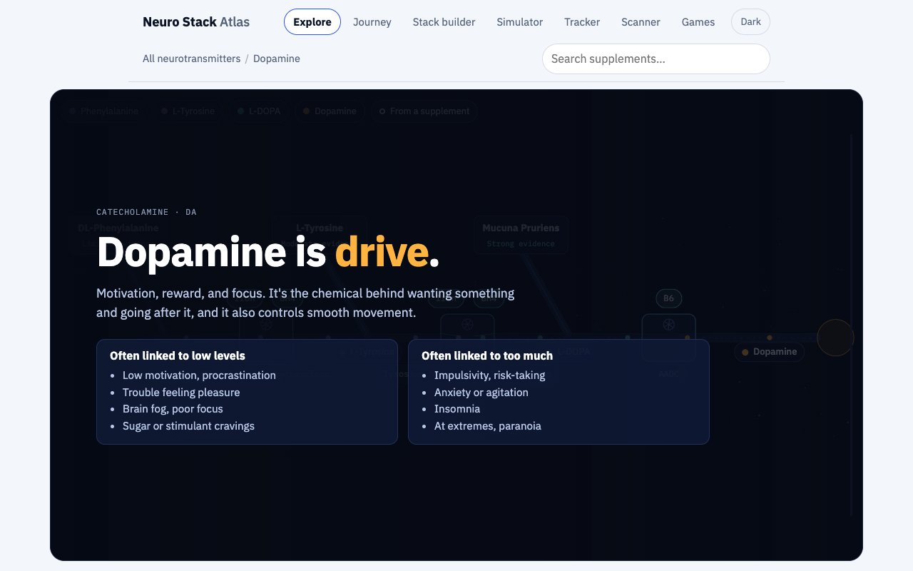 | 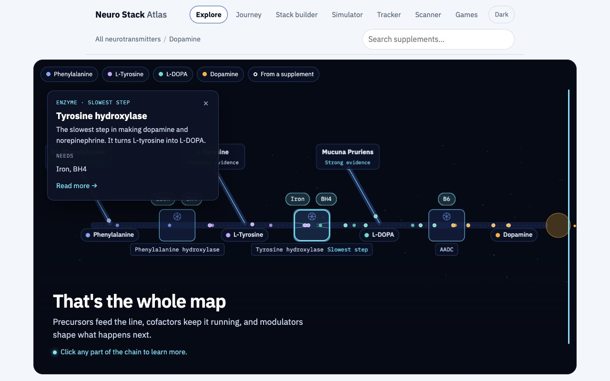 |
| 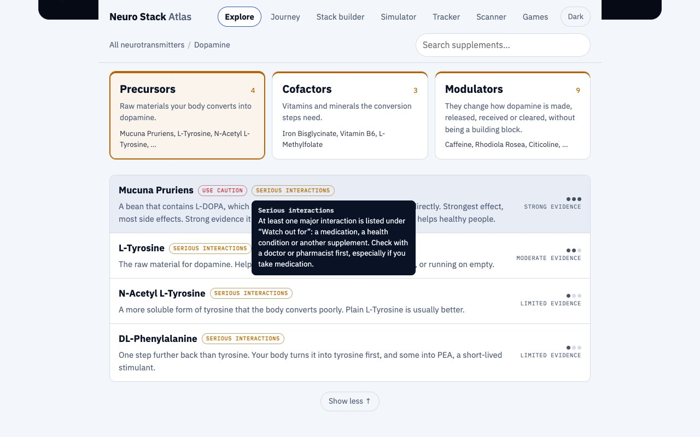 | 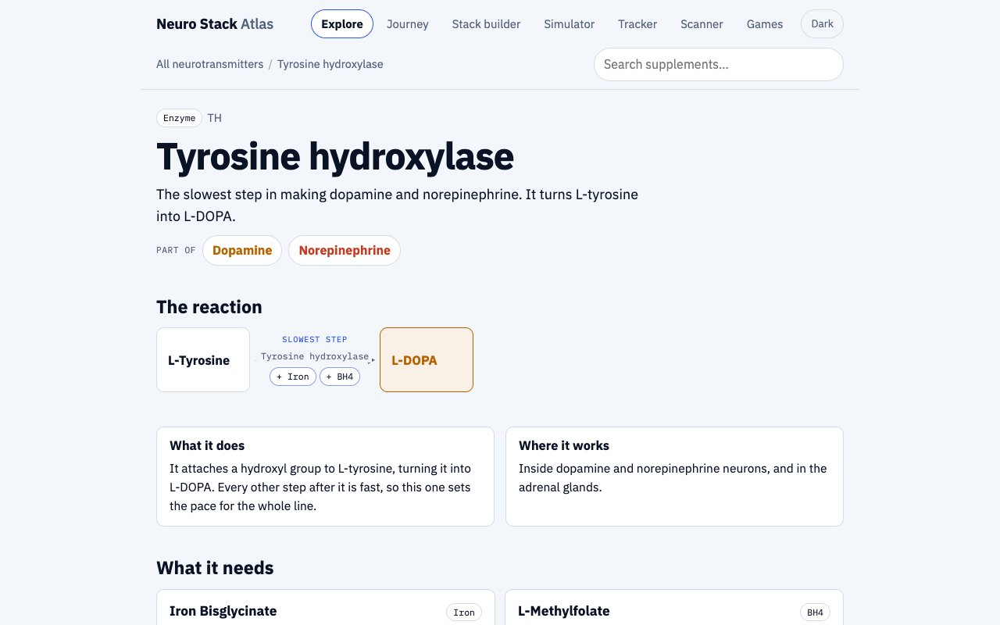 |
| 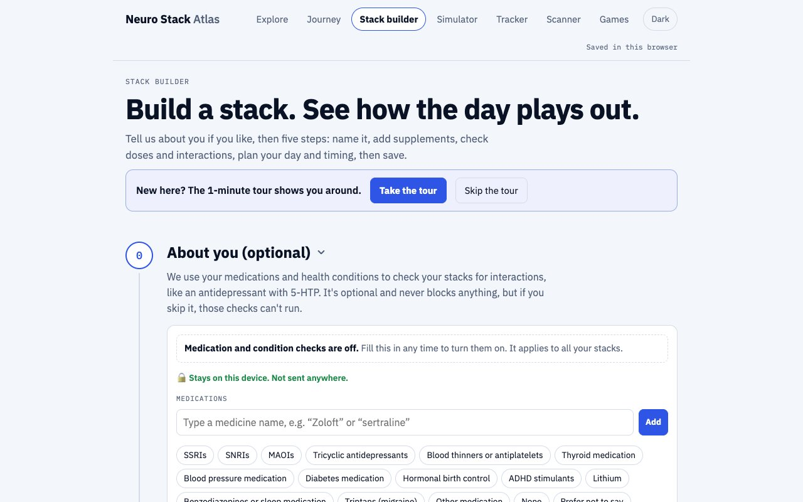 | 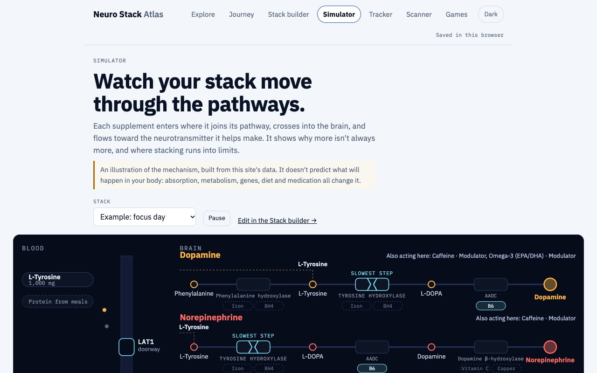 |
| 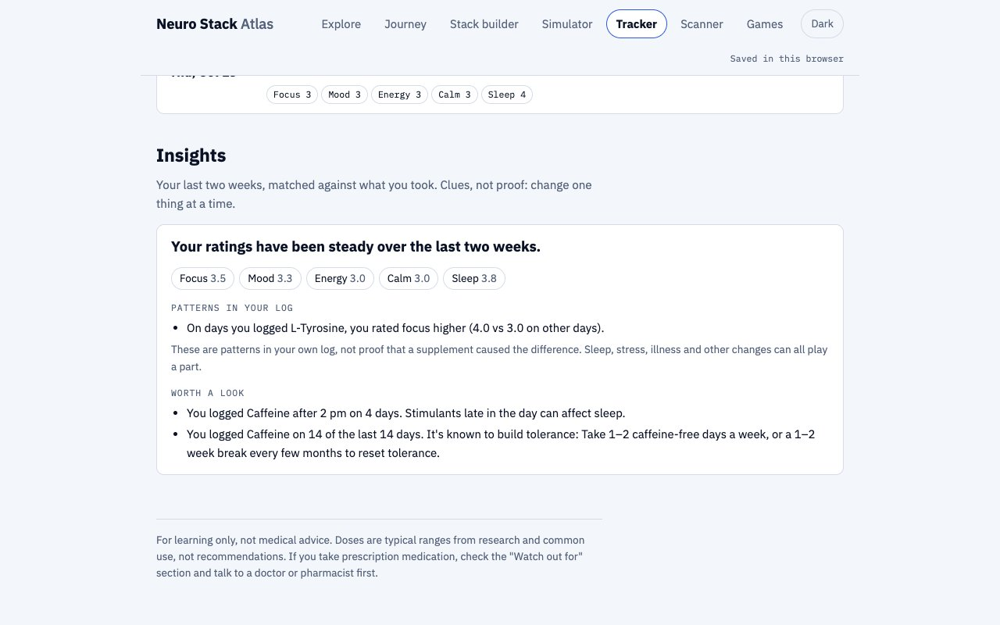 | 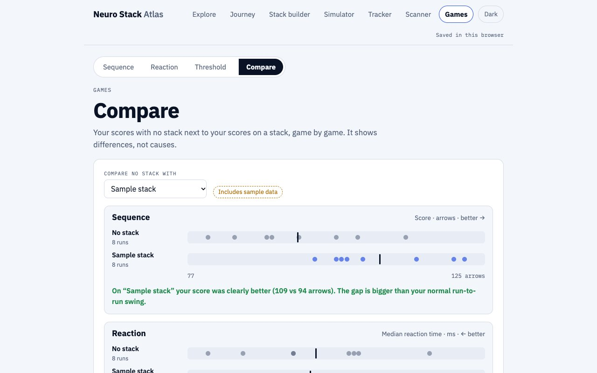 |

## Key product decisions

- **Evidence ratings everywhere.** Every supplement-to-neurotransmitter link is rated *strong*, *moderate*, *limited* or *theoretical*. Lists are sorted by evidence, and weaker findings (animal studies, early data) are labeled as such.
- **Teach the mechanism, not just the outcome.** The assembly line shows *where* each supplement joins: precursors before the slowest step (like L-tyrosine) are gentler, because the body still sets the pace; anything after it (like L-DOPA from Mucuna) skips that brake.
- **Cofactors are first-class.** Enzymes don't run without vitamins and minerals (iron, B6, vitamin C, copper…). The site shows which enzyme needs which cofactor, and the Stack builder suggests missing ones.
- **Safety gates you can't scroll past.** The stack check covers interactions, medications and conditions, total load, doses and side effects, rated from minor to critical. A serious or critical finding pauses the day planner and the Tracker until each one is reviewed and the stack is approved. Changing a dose or a supplement asks again; moving a time doesn't.
- **What vs when.** The check (what's in the stack, how much) is kept apart from timing advice (spacing, time of day, food). Timing tips never block anything, so they can't wear out the warnings that matter.
- **Foundation before hacking.** The home page teaches foundation, cycling and recovery *before* it hands over the neurotransmitter pages.
- **Patterns, never causes.** The Tracker reports patterns ("on days you logged X, you rated Y higher"), needs 10+ logged days before linking a supplement to a change, and shows a safety message with a crisis line when mood stays low. Games' Compare skips warm-up runs, warns about practice effects, and describes differences without claiming the stack caused them.
- **No medical claims.** Disclaimers sit near the top of the home page ("talk to your doctor"). Supplements with serious risks or major interactions carry tags that explain themselves on hover. The Simulator says plainly that it illustrates the mechanism and doesn't predict what will happen in your body.
- **Plain language up front, depth on demand.** The home page avoids jargon; enzyme pages and info cards go deeper for people who want it.
- **Private by default.** No accounts and no server: medications, stacks, tracker logs and game scores stay in the visitor's own browser.

## How it's built

- **Plain HTML, CSS and JavaScript.** No framework and no build step; GitHub Pages serves the files as they are.
- **Scroll-driven SVG scenes.** Each scene maps scroll position to a camera and to animation states, so it plays at the reader's pace. The assembly line lays itself out from each neurotransmitter's pathway data, so all six pages share one scene, and the Simulator reuses the same data for all six at once.
- **Content separate from code.** All the data and wording lives in [`content/`](content/) as clearly labeled files, with editing notes, so it can be edited without touching code ([guide](content/README.md)). Journey and Simulator captions carry their sources, and side-effect entries track whether they've been reviewed.
- **Review loop.** [`tools/`](tools/) holds the scripts used to review every change: repeatable screenshots at desktop, iPad and phone sizes (headless Chrome with a frozen clock), frame-by-frame contact sheets for the Journey, a before/after comparison page, a content diff, and click-through tests for the neurotransmitter pages, Stack builder, stack check, medication safety, Journey and Games.
- **Deployment.** A GitHub Actions workflow publishes only the site files to GitHub Pages on every push to `main`.

```
index.html        page shell
css/              theme tokens + styles by area
js/               router, pages, scroll scenes, journey, stack builder + checker, simulator, tracker, games, scanner
content/          data and wording (supplements, pathways, medications, side effects, captions, enzymes)
tools/            review tooling (screenshots, journey frames, comparison, tests)
baseline/         the original single-file prototype, kept for comparison
docs/images/      README images
```

To run it locally:

```bash
python3 tools/serve.py 8010
```

Then open http://localhost:8010. (`serve.py` turns off caching, so the browser never shows a stale script.)

## How it was made

This project was **built with AI under my direction.** It started as a single-file prototype in a claude.ai artifact. I then worked with Claude (Anthropic's AI coding assistant) to turn it into a maintainable project and develop it further. Claude wrote the code. I set the product direction and priorities, made the content and safety decisions, and reviewed every change before it was saved. The Journey's science wording also had a review pass from a separate Claude instance acting as a medical reviewer.

The git history shows the path: the original one-file prototype, the mechanical split into a static project (verified identical to the original), then each round of product changes.

## Status

- Desktop first; a mobile pass is planned.
- The Games are a proof of concept; scores stay in the browser for now.
- The Scanner runs in basic mode on this site (paste the label text). Photo scanning only works inside claude.ai.
- Many side-effect entries are still marked unreviewed in `content/side-effects.js`; reviewing them against sources is ongoing.
- Next: a logo, a Tracker walkthrough, and the Simulator's time slider.
